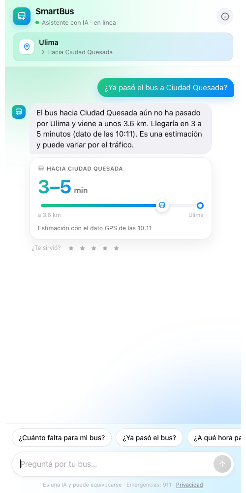
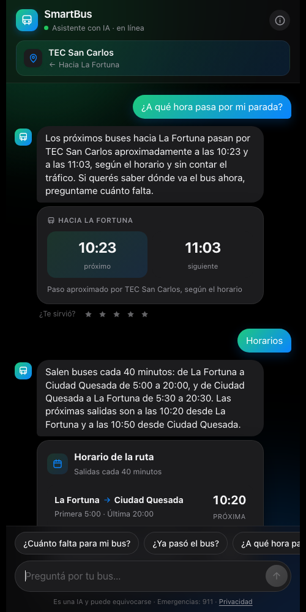
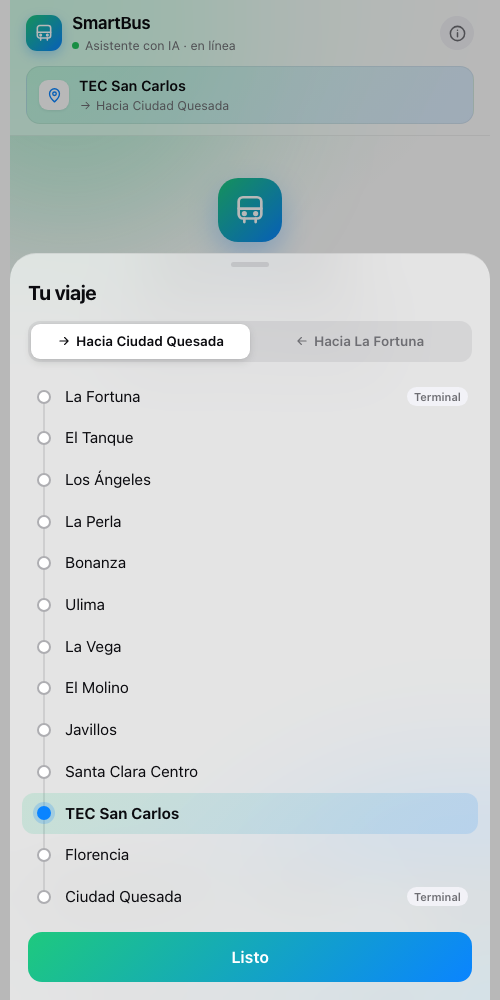
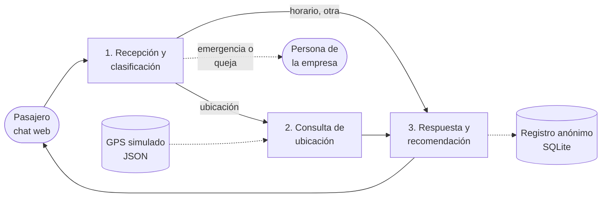

# SmartBus Asistente

**Chat web con tres agentes de IA que le dice al pasajero dónde está su bus y cuánto falta para que llegue.**

Producto mínimo viable (MVP) del plan de empresa **SmartBus CR**, desarrollado para el curso *Computación y Sociedad* del Instituto Tecnológico de Costa Rica.


<p align="center">
  
  
  
</p>

---

## El problema

Una estudiante espera el bus a las 5:45 a. m. para llegar a una evaluación. No sabe si el bus ya pasó ni cuánto falta. Las empresas de transporte, por su parte, reciben las mismas preguntas una y otra vez por mensajes y llamadas.

SmartBus Asistente responde una sola necesidad: **«¿cuándo llega mi bus?»**, con datos GPS, en lenguaje sencillo y con la recomendación del siguiente paso: esperar, tomar el siguiente bus o contactar a la empresa.

📄 El contexto completo (idea de negocio, mapa de empatía, formalización, presupuesto y diseño del MVP) está en el plan de empresa: [`docs/SmartBus_CR.pdf`](docs/SmartBus_CR.pdf).

## Qué hace

- **Ubicación y tiempo estimado** del próximo bus hacia tu parada, en rango («3 a 5 minutos») y con la hora del dato GPS.
- **Hora aproximada de paso** por cualquier parada, según el horario.
- **Horarios** de la ruta en los dos sentidos.
- **Casos límite**: dato GPS desactualizado (avisa y baja la confianza), ruta sin datos (no inventa un tiempo) y emergencias (911 y derivación a una persona).
- **Conversación natural** con memoria corta, sin inventar datos de buses.
- **Tarjetas visuales** para cada tipo de respuesta y **valoración** de 1 a 5 estrellas.
- **Panel de demostración** con el recorrido en vivo, una ficha por bus y las métricas del registro anónimo.

Ruta piloto (simulada): **La Fortuna – El Tanque – Los Ángeles – La Perla – Bonanza – Ulima – La Vega – El Molino – Javillos – Santa Clara Centro – TEC San Carlos – Florencia – Ciudad Quesada**, en los dos sentidos, con tres unidades.

## Arquitectura

El mensaje pasa por tres agentes en orden. **El modelo de lenguaje nunca calcula ni inventa cifras**: los tiempos los calculan reglas a partir del GPS, y el modelo solo clasifica y redacta.



| Agente | Qué hace | IA |
|---|---|---|
| **Recepción y clasificación** (`app/agentes/recepcion.py`) | Clasifica el mensaje (ubicación, horario, incidencia u otra), detecta parada, sentido y casos sensibles. | Reglas primero; el modelo interpreta los mensajes que las reglas no reconocen. Nunca puede quitar una derivación. |
| **Consulta de ubicación** (`app/agentes/ubicacion.py`) | Busca la posición más reciente de cada bus en el sentido del pasajero y calcula el tiempo con distancia ÷ velocidad promedio reciente. | Sin IA, por diseño. |
| **Respuesta y recomendación** (`app/agentes/respuesta.py`) | El código decide los hechos y el siguiente paso; el modelo los redacta en lenguaje natural. | Si el texto del modelo cambia una cifra, omite un aviso o inventa un consejo, se descarta. |

**Decisiones de diseño**

- **Seguridad ante todo.** Las palabras de emergencia se detectan con reglas que siempre corren. Si la IA falla en un caso de emergencia, se muestra un texto fijo con el 911 y el contacto.
- **Privacidad (Ley N.º 8968).** El registro solo guarda categoría, ruta, tiempo de respuesta y valoración. No guarda el texto del mensaje, ni la ubicación, ni identificadores. La memoria de la conversación vive solo en el navegador.
- **Funciona sin IA.** Sin un modelo disponible, el sistema responde con reglas y plantillas. Con IA, se puede elegir un proveedor gratuito.

## Cómo ejecutarlo

Requiere Python 3.9 o superior.

```bash
git clone https://github.com/ubeda-alex/SmartBus.git
cd SmartBus
python3 -m venv .venv
.venv/bin/pip install -r requirements.txt
.venv/bin/uvicorn app.main:app --port 8000
```

| Página | Dirección |
|---|---|
| Chat del pasajero | http://localhost:8000 |
| Panel de demostración | http://localhost:8000/demo |
| Ver qué hizo cada agente | http://localhost:8000/?traza=1 |

**Desde un celular** en la misma red Wi-Fi: arrancá con `--host 0.0.0.0` y abrí `http://<IP-de-tu-compu>:8000`. En iPhone, «Compartir → Agregar a pantalla de inicio» lo abre a pantalla completa.

### Modelo de lenguaje (opcional)

Copiá `.env.example` como `.env` y elegí un proveedor. Todos tienen una opción gratuita salvo Anthropic.

| Proveedor | Costo | Configuración |
|---|---|---|
| [Ollama](https://ollama.com) (local) | Gratis, sin cuenta | Instalarlo y descargar un modelo; se detecta solo |
| [Gemini](https://aistudio.google.com) | Plan gratuito | `SMARTBUS_PROVIDER=gemini` y `GEMINI_API_KEY` |
| [Groq](https://console.groq.com) | Plan gratuito | `SMARTBUS_PROVIDER=groq` y `GROQ_API_KEY` |
| Anthropic | De pago | `SMARTBUS_PROVIDER=anthropic` y `ANTHROPIC_API_KEY` |

El panel de demostración indica qué modo está activo. Los planes gratuitos tienen límites de uso: si se agotan, el chat sigue funcionando y avisa.

## Pruebas

20 escenarios simulados del plan de validación (incluidos los casos límite) y casos adicionales encontrados al probar a mano. Corren sin modelo de lenguaje, así que son deterministas.

```bash
.venv/bin/python -m pytest -q              # 35 pruebas
.venv/bin/python -m tests.test_escenarios  # tabla legible de los 20 escenarios
```

## Estructura

```
├── app/
│   ├── agentes/          # los tres agentes
│   ├── static/           # chat (index.html) y panel de demostración (demo.html)
│   ├── gps.py            # simulador de GPS (posiciones nuevas cada 30 s)
│   ├── llm.py            # proveedores de modelo de lenguaje
│   ├── pipeline.py       # flujo recepción → ubicación → respuesta
│   ├── registro.py       # registro anónimo en SQLite
│   └── main.py           # API (FastAPI)
├── data/ruta_piloto.json # paradas, distancias, horarios y contacto
├── docs/                 # plan de empresa (PDF) y capturas
└── tests/                # escenarios de validación
```

## Alcance y limitaciones

- **Datos simulados.** Las posiciones GPS, las distancias entre pueblos (aproximadas), los horarios y el teléfono de la empresa son de ejemplo y se cambian en `data/ruta_piloto.json` sin tocar código.
- **Ruta piloto.** El plan de empresa describe una ruta Cartago–campus; el prototipo se implementó con la ruta La Fortuna–Ciudad Quesada.
- **Fuera del alcance del MVP.** No incluye GPS reales, autenticación, notificaciones ni panel administrativo para la empresa; están listados como trabajo futuro en el plan.

## Equipo

Alexander Ubeda · Andres Quiros · Erick Duran · Ryan Vargas

Curso *Computación y Sociedad*, Escuela de Ingeniería en Computación, Instituto Tecnológico de Costa Rica. Profesor: Abel Mendez. Octubre de 2026.

---

<details>
<summary><b>English summary</b></summary>

SmartBus Asistente is the MVP of *SmartBus CR*, a business plan for a Costa Rican fleet-technology company. It is a mobile-first web chat where three AI agents answer bus passengers' most common question, "when does my bus arrive?", using simulated GPS data. A reception agent classifies the message and detects emergencies, a rules-based location agent computes the arrival-time range, and a response agent phrases the answer. The language model never produces numbers: its output is validated and discarded if it alters a figure or drops a warning. Built with Python, FastAPI, SQLite and vanilla HTML/CSS/JS; works with free LLM providers (Ollama, Gemini, Groq) or with no model at all.

</details>
